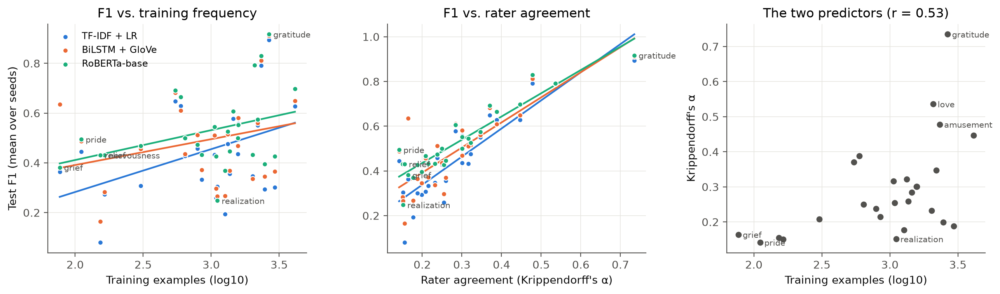
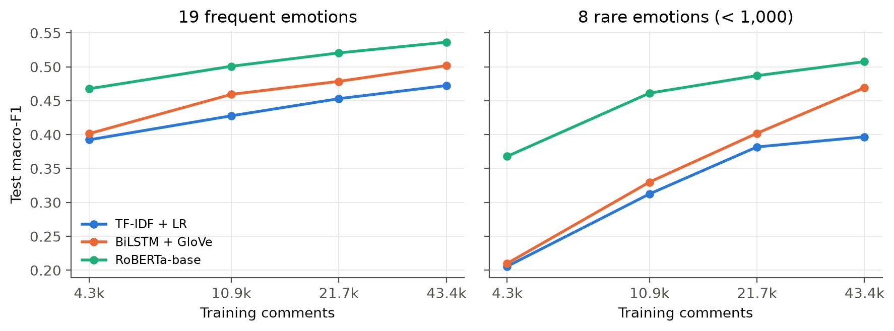
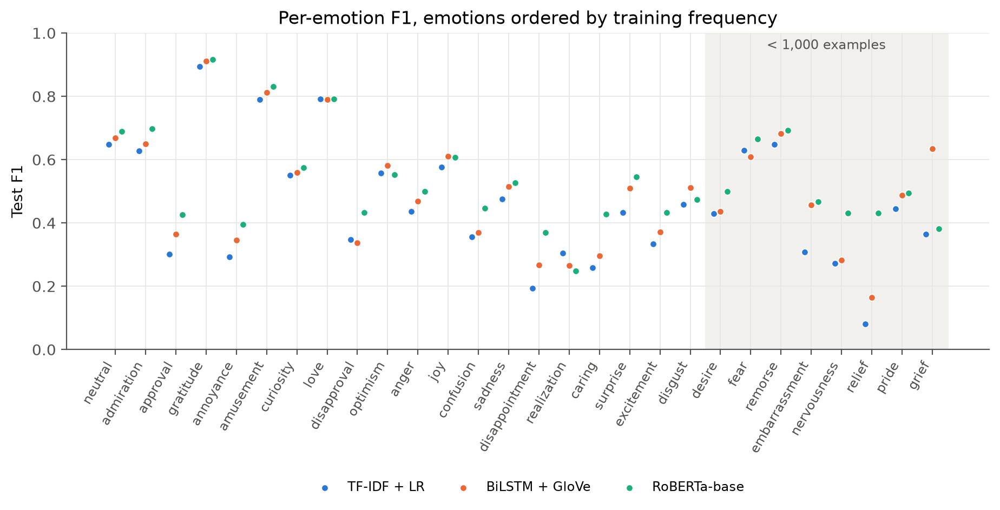
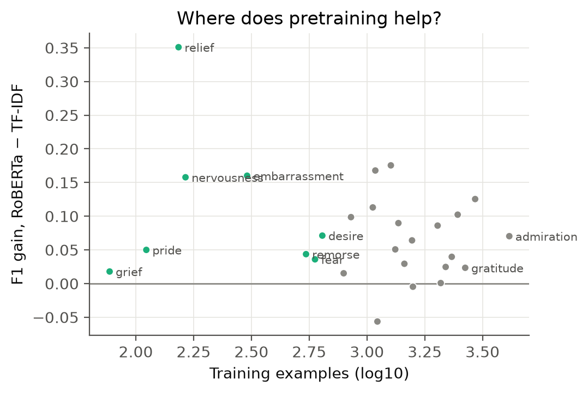
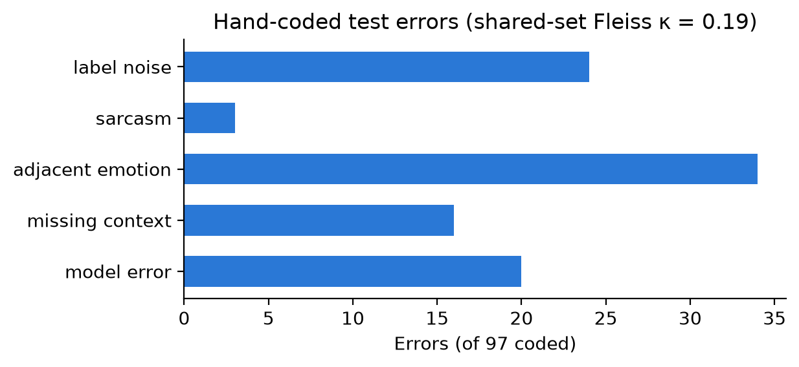

**Code, data and predictions:** https://github.com/taxpet06/goemotions-final. Every number here is produced by `analysis.py` from the saved model scores.

## 1. Problem and research question

Emotion classifiers are used to triage support tickets, route peer-support posts and flag escalating conflict. The emotions that matter most there (grief, nervousness, fear) have the least training data, so a model can post a good average score while missing most of them. We asked how per-emotion performance on GoEmotions depends on the text representation, the training data per emotion, and how consistently human raters agree on the emotion, through three sub-questions: **(1)** does the F1 gap between a lexical baseline and a fine-tuned transformer grow as an emotion gets rarer; **(2)** does per-emotion F1 track rater agreement more than frequency; and **(3)** how many errors come from ambiguous or wrong labels rather than real model mistakes? The task is multi-label classification: each Reddit comment has a 28-dimensional binary target (27 emotions plus neutral), and every model outputs 28 independent sigmoid scores.

## 2. Data

GoEmotions (Demszky et al., 2020) has 58,009 English Reddit comments, each labelled by three raters (two more when no two agreed on any label); all raters were native English speakers from India. Google's filtered release (Google Research, 2020), which we use, keeps a label only when at least two raters chose it: 54,263 comments in a fixed 80/10/10 split (Apache 2.0). Names and religions are masked as `[NAME]` and `[RELIGION]`. Comments are short (mean 12.8 words), 16% have two or more labels, and neutral covers 32.8%. Classes are highly imbalanced: admiration has 4,130 training examples, grief 77. The eight emotions with fewer than 1,000 examples in total (desire, embarrassment, fear, grief, nervousness, pride, relief, remorse) form the "rare" group, fixed in the proposal before any result existed.

**Leakage.** 43 dev and 37 test comments have exactly the same text as a training comment, and 5 more test comments duplicate dev comments (dev is used for tuning). We removed all 85 from evaluation, leaving 43,410 / 5,383 / 5,385 train / dev / test comments; training data is unchanged.

**Rater agreement.** From Google's per-rater files we keep 191,639 ratings of 54,178 comments (2 to 5 per comment), after dropping ratings marked "very unclear" and comments outside our splits. For each emotion, treated as a yes/no judgement, we compute **Krippendorff's α** (Krippendorff, 2011). It corrects for chance agreement, which matters for rare labels where raters agree on "no" almost by default, and handles a varying number of raters. α ranges from 0.14 (pride) to 0.73 (gratitude), median 0.25; our code matches the `krippendorff` package to machine precision.

## 3. Methods

**Preprocessing and features.** All systems see the same splits and only the comment text (no subreddit or author, so models cannot shortcut through community identity). For TF-IDF and the BiLSTM, text is lowercased and tokenized by one regular expression that keeps `[name]`/`[religion]` whole and makes each emoji and punctuation mark a token; scikit-learn's default would drop "😂" and "!", which are strong cues. TF-IDF uses word 1-2 grams, min_df = 2 and sublinear term frequency. The BiLSTM's vocabulary is every training word seen at least twice, initialized with 300-d GloVe 6B vectors (Pennington et al., 2014; 98% coverage) and fine-tuned. RoBERTa uses its own byte-level BPE tokenizer (max 64 subwords, which covers every comment).

**Table 1. Systems** (final settings chosen on dev from the grid shown).

| System | Final configuration | Grid searched |
|---|---|---|
| Prior / always neutral | Each label drawn at its training frequency (3 seeds) / only neutral | none |
| TF-IDF + LR | One-vs-rest logistic regression, `class_weight=balanced`, C = 1, 1-2 grams | C ∈ {0.1, 1, 10} × n-grams {1, 1-2} |
| BiLSTM + GloVe | 1 layer, 256 units per direction, masked max-pool, dropout 0.5; Adam lr 1e-3, batch 64, ≤ 10 epochs | hidden {128, 256} × lr {1e-3, 3e-4}; 3 seeds |
| RoBERTa-base | Fine-tuned end to end; AdamW lr 3e-5, weight decay 0.01, 6% warm-up then linear decay, batch 32, ≤ 5 epochs | lr {1e-5, 2e-5, 3e-5}; 3 seeds |

TF-IDF + LR uses scikit-learn (Pedregosa et al., 2011). RoBERTa (Liu et al., 2019) keeps BERT's architecture (Devlin et al., 2019) but is pretrained longer on more text; we load `roberta-base` through Hugging Face Transformers (Wolf et al., 2020). Both neural models clip gradients at 1.0 and use weighted binary cross-entropy with `pos_weight = sqrt(neg/pos)` per label; the full ratio (about 560 for grief) made early training unstable.

**Protocol.** Every choice was made on dev, and test was scored once per final model. *Per-label thresholds:* for every model, seed and label, the threshold in {0.01, ..., 0.99} that maximizes that label's dev F1 (Lipton et al., 2014). *Early stopping:* neural models are scored on dev after each epoch and the best epoch is kept (epochs 3-4 for RoBERTa, 5-9 for the BiLSTM). *Selection* uses mean dev macro-F1 over seeds: TF-IDF 0.494, BiLSTM 0.534, RoBERTa 0.562 (its three learning rates, 0.559 / 0.558 / 0.562, are within seed noise). Neural results are mean ± SD over 3 seeds, run on the Dartmouth Discovery `gpu_preempt` partition (V100, RTX 2080 Ti, L40S or H200, logged per run); TF-IDF is deterministic and ran on a laptop CPU.

**Metrics.** The primary metric is test **macro-F1**, which weights grief the same as admiration; we also report micro-F1 and per-emotion precision, recall and F1. To separate ranking quality from thresholds we report average precision (AP). Following the proposal feedback, raw AP is not comparable across emotions because a random scorer's AP equals the prevalence p, so we add **ROC-AUC** (0.5 for random at any prevalence) and **prevalence-normalized AP**, (AP − p)/(1 − p), which is 0 for random and 1 for perfect. Uncertainty comes from a **paired bootstrap** (Efron & Tibshirani, 1993): 1,000 resamples of the test comments, shared across systems, so model differences get their own 95% confidence intervals (CIs); neural models average their seeds within each resample.

## 4. Results

**Table 2. Test results** (5,385 comments; mean ± SD over seeds; 95% bootstrap CI for macro-F1).

| System | Macro-F1 [95% CI] | Micro-F1 | ROC-AUC | AP | Norm. AP |
|---|---|---|---|---|---|
| Prior | 0.042 [0.040, 0.045] | 0.126 | 0.500 | 0.042 | 0.000 |
| Always neutral | 0.018 [0.017, 0.018] | 0.305 | 0.500 | 0.042 | 0.000 |
| TF-IDF + LR | 0.457 [0.433, 0.476] | 0.530 | 0.901 | 0.412 | 0.389 |
| BiLSTM + GloVe | 0.498 ± 0.005 [0.470, 0.518] | 0.572 | 0.917 | 0.478 | 0.457 |
| RoBERTa-base | **0.534 ± 0.003** [0.510, 0.552] | **0.602** | **0.931** | **0.521** | **0.502** |

Paired differences in macro-F1 are all clearly positive: RoBERTa − TF-IDF +0.077 [0.056, 0.096], RoBERTa − BiLSTM +0.035 [0.016, 0.053], BiLSTM − TF-IDF +0.041 [0.027, 0.055]; no resample reversed any ordering. The ranking is identical on the threshold-free metrics, so it does not come from threshold tuning. The floors show why macro-F1 is primary: always-neutral reaches 0.305 micro-F1 but 0.018 macro-F1. Per-emotion results are in Supplementary Table S1 and Figure S1; all three models rise and fall together across emotions (gratitude is easy for all, realization hard for all).

**Threshold sensitivity** (Table S2). Over a single 0.5 cutoff, per-label thresholds add +0.012 macro-F1 for TF-IDF, +0.028 for the BiLSTM and +0.037 for RoBERTa, mostly on rare emotions (RoBERTa rare-8 F1 0.432 → 0.508). `pos_weight` shifts each label's score scale differently, so one cutoff fits the neural models poorly, while class-weighted logistic regression is already close to calibrated. Demszky et al. report 0.46 macro-F1 for fine-tuned BERT, and Google's released code uses one global threshold (0.3); our RoBERTa is 0.07 higher, most likely because of per-label thresholds.

## 5. Investigations

### 5.1 Frequency and agreement, fitted jointly

The proposal feedback warned that frequency and ambiguity may be confounded. They are: across the 27 emotions, log training frequency and α correlate at **r = 0.53** (Spearman ρ = 0.52, p = 0.005). So for each model we fit one OLS regression of per-emotion test F1 on both predictors, standardized so coefficients are comparable (n = 27; neutral excluded as a non-emotion with 14k examples).

**Table 3. Per-emotion F1 regressed on z(log10 training count) and z(α)** (F1 change per 1 SD; 95% CI).

| Outcome | b, log frequency | b, agreement | R² | r, freq. alone | r, α alone |
|---|---|---|---|---|---|
| TF-IDF F1 | −0.017 [−0.060, 0.025] | **0.182** [0.139, 0.224] | 0.80 | 0.41 | 0.89 |
| BiLSTM F1 | −0.047 [−0.092, −0.001] | **0.179** [0.133, 0.224] | 0.75 | 0.26 | 0.84 |
| RoBERTa F1 | −0.028 [−0.054, −0.003] | **0.157** [0.132, 0.183] | 0.89 | 0.36 | 0.93 |
| RoBERTa − TF-IDF gap | −0.011 [−0.047, 0.025] | −0.024 [−0.060, 0.012] | 0.16 | −0.30 | −0.38 |

Alone, frequency correlates moderately with F1 (r ≈ 0.3 to 0.4). With agreement in the model, frequency's coefficient is near zero and slightly negative, while 1 SD of α (0.14) goes with +0.16 to +0.18 F1; agreement alone explains 70% to 86% of the variance. The variance inflation factor is 1.38, so the predictors are correlated but separable, and bootstrapping the 27 emotions gives a similar interval for RoBERTa's agreement coefficient ([0.134, 0.209]). We read the negative frequency coefficient as "no positive effect once ambiguity is accounted for", not as rarity helping: it is fragile (TF-IDF's CI includes 0), and the rare high-α emotions (fear, remorse) have very distinctive words ("scared", "sorry"). **Sub-question 2: yes.** Within GoEmotions' range (77 to 4,130 training examples), how consistently humans apply a label predicts F1 far better than the number of examples, e.g. realization (1,110 examples, α 0.15, RoBERTa F1 0.25) versus fear (596, α 0.39, F1 0.67) (Figure 1).

### 5.2 Does pretraining help most where data is scarce?

At full data, RoBERTa's mean F1 gain over TF-IDF is +0.111 on the rare emotions and +0.064 on the 19 frequent ones; the difference, +0.047, has a paired bootstrap CI of [−0.016, 0.108] (one-sided p = 0.07), and neither predictor explains the gap (Table 3, last row). RoBERTa is worse than TF-IDF only on realization (−0.06), the lowest-agreement frequent emotion (Figure S2).

### 5.3 Learning curves

We retrained each chosen configuration on nested random 10%, 25% and 50% subsets of the training set (one seed each). **RoBERTa trained on 10% of the data (4.3k comments) scores 0.446 macro-F1, almost the 0.457 TF-IDF reaches with all 43k.** At 10% data RoBERTa leads TF-IDF by +0.16 F1 on rare emotions (0.368 vs 0.206) but only +0.08 on frequent ones; at full data the gaps shrink to +0.11 and +0.06 (Figure 2). **Sub-question 1:** pretraining's advantage on rare emotions is clear when they are very rare (8 to 64 training examples each at 10%) and narrows as data grows, so at full size it is within noise. The BiLSTM's rare-emotion curve is still climbing at 100% (0.402 → 0.469) while TF-IDF's has flattened (0.382 → 0.397).

### 5.4 Coarse labels (Ekman)

Retrained on GoEmotions' Ekman grouping (anger, disgust, fear, joy, sadness, surprise, plus neutral; Ekman, 1992), TF-IDF scores 0.581 macro-F1 and RoBERTa 0.639 (3 seeds). The fine-grained models' own predictions collapsed to those groups score 0.571 and 0.638, essentially the same, so the 28-way models already find the right family and the remaining error is not about sibling emotions. (We compare collapsed with trained, since macro-F1 over 7 and 28 classes is not comparable.)

### 5.5 Error analysis

**Confusions** (RoBERTa, seed 0). 3,228 test comments (60%) have at least one wrong label. Pairing each missed gold label with each wrongly predicted label in the same comment, the most frequent pairs almost all involve **neutral**: annoyance → neutral (73), disapproval → neutral (64), neutral → approval (57), realization → neutral (54); the only frequent emotion-emotion pair is anger → annoyance (46). Only 14% of erroneous comments contain a missed and a predicted label from the same Ekman family. Most errors concern *whether* there is an emotion, and the boundary emotions have low α: approval 0.19, annoyance 0.20, realization 0.15, disappointment 0.18.

**Hand-coded sample.** We drew 100 erroneous test comments at random and gave each the first applicable category in this order: label noise (gold label wrong or incomplete), missing context (text alone cannot decide), sarcasm, adjacent emotion (gold and prediction both defensible, including faint emotion versus neutral), and model error (gold clearly right, text sufficient). All three of us coded the same 20 independently and split the other 80; no AI tool was used for coding. Shared comments take the majority vote, and 3 three-way ties are excluded (n = 97). The breakdown is 35% adjacent emotion, 25% label noise, 16% missing context, 3% sarcasm and 21% model error (Figure S3). Agreement on the shared 20 was low (Fleiss' κ = 0.19; all three agreed on 3), mostly over "adjacent emotion" (26 of 37 disagreeing pairs), so the label-side shares are unreliable; whether an error is a real model error is more stable (κ = 0.41). **Sub-question 3:** about four in five errors trace to ambiguous or wrong labels, or text that cannot be judged alone, rather than clear model mistakes.

## 6. Interpretation, limitations and next steps

**What the results show.** Pretraining gives the best model, and contextual representations help most when an emotion has very few examples. The ordering of the three models fits what each representation can see: the BiLSTM beats TF-IDF (+0.041) through word order, negation and GloVe word similarity, and loses to RoBERTa (−0.035) because its word vectors do not change with context and it has no sentence-level pretraining. But *which* emotions any model gets right is decided mostly by how consistently humans apply the label, not by data size or architecture. The likely mechanism: emotions like realization or approval have no stable lexical signature, so raters disagree, and the two-rater rule turns that disagreement into inconsistent gold labels in both train and test. A model cannot learn a sharp boundary from such labels, and the test labels cap the F1 it can reach; gratitude ("thanks") and amusement ("lol", "😂") are the opposite case. Three further results point the same way: errors concentrate on the emotion-versus-neutral boundary, coarsening to Ekman families removes almost none of them, and even our own coders agreed only slightly on the error categories.

**Limitations.** (1) *27 data points:* every per-emotion analysis is a regression on 27 emotions, and rare emotions have 5 to 83 test examples, so their F1 is noisy and the full-data gap test is underpowered. (2) *Agreement and gold labels share a source:* α comes from the ratings that define the labels, so low agreement means both a harder concept and noisier test labels, which we cannot separate without re-annotation; our own error categories are unreliable too (κ = 0.19). (3) *Small dev counts for thresholds:* grief has 13 dev examples, so its threshold may be overfit. (4) *One domain and rater pool:* Reddit English rated by speakers in India; nothing was tested on support tickets or forums. (5) *Grid edges:* BiLSTM lr 3e-4 and RoBERTa lr 1e-5 were still improving at their epoch caps (the chosen configurations peaked earlier), and runs used different GPUs without forced determinism (seed SD 0.003 covers this).

**Next steps, each tied to a limitation.** *(1, 2) Soft labels:* train and evaluate on the share of raters choosing each emotion instead of the two-rater cut; if low-α emotions are fuzzy rather than unlearnable, they should gain most. *(2) Re-annotation:* have new raters, with sharper written rules than ours, relabel the low-α, high-error emotions (realization, approval, annoyance) to measure label noise directly. *(1) Pooled rare emotions or a larger rare-emotion test set,* so the gap test has power. *(3) Cross-validated thresholds,* or one shared threshold for labels with fewer than about 30 dev examples. *(4) An out-of-domain test* on support-forum posts before any claim about triage.

## 7. Changes from the proposal

| Change | Why |
|---|---|
| Frequency and agreement fitted jointly, with their correlation reported | Proposal feedback: they are confounded (r = 0.53) |
| ROC-AUC and prevalence-normalized AP added next to raw AP | Proposal feedback: random AP equals the base rate |
| Agreement measured with Krippendorff's α | No statistic was named; α handles 2 to 5 raters |
| Also removed 5 test comments duplicated in dev | Dev is used for tuning, so these leak too |
| `pos_weight = sqrt(neg/pos)`; BiLSTM fixed at 1 layer; all RoBERTa lrs with 3 seeds | Full ratio destabilized training; grid kept to the named factors; more reliable selection |
| Stretch goals done (learning curves, Ekman for TF-IDF and RoBERTa, threshold sweep); BiLSTM Ekman skipped | Time allowed all but one |
| Category priority order for hand coding; ties excluded | Several categories often applied to one error |
| Discovery GPUs instead of Colab; no live demo | Available GPUs; the final assignment requires slides only |

## 8. Reproducibility

The README gives exact commands; versions are pinned in `requirements.txt` (CPU) and `requirements-gpu.txt` (GPU). Pipeline: `prep.py` → `baselines.py` (CPU, ~15 min) → `neural.py` runs (GPU; one line per run in `cluster/runs/*.sh`, e.g. `python neural.py roberta --lr 3e-5 --seed 0`) → `analysis.py` → `error_summary.py`. All dev and test scores are committed, so `python analysis.py` regenerates every table and figure, including the principal results (Table 2 and Table 3), in about 10 seconds without retraining. `test_common.py` checks our F1, threshold, tokenizer and α code against scikit-learn and the `krippendorff` package.

## 9. Team contributions

We divided the work as planned in the proposal, and all three of us shared the design decisions, the report and the presentation.

- Aaron Desmond owned the data pipeline and baselines. He worked on the leakage removal (85 duplicated dev/test comments), the prior and TF-IDF baselines with their grid search, and the shared paired-bootstrap evaluation.
- Alexander Cook owned the BiLSTM and the rater-agreement analysis. He worked on the BiLSTM configuration, the Krippendorff's α computation from the raw per-rater files, the joint regression of F1 on frequency and agreement, and the learning curves.
- Petros Taxiarchis owned RoBERTa, threshold tuning and the Ekman variant. He ran the GPU experiments on Discovery, and assembled the report and slides.
- All three independently hand-coded the shared 20 errors and split the remaining 80, interpreted the results, and edited the report.

## 10. Generative AI disclosure

The team used Claude Opus 5.5 to generate initial implementations for multiple scripts throughout the pipeline and to toubleshoot errors in them as well as hunt for bugs and fix them. We made sure that we understood every line of generated code and have heavily revised the code manually to match our dataset. We frequently tested generated code manually to ensure that it worked as intended and never blindly trusted generated code. Claude was also used to design our slides. However, all content within the slides was generated by us manually and we told Claude exactly what to put on each slide and with what format. When it comes to prose, Claude was used for syntactical, vocabulary, grammar, and spelling corrections, after the report was already complete.

## References

1. Demszky, D., Movshovitz-Attias, D., Ko, J., Cowen, A., Nemade, G., & Ravi, S. (2020). GoEmotions: A Dataset of Fine-Grained Emotions. *ACL 2020*. arXiv:2005.00547.
2. Google Research (2020). GoEmotions data and documentation. github.com/google-research/google-research/tree/master/goemotions.
3. Liu, Y., Ott, M., Goyal, N., et al. (2019). RoBERTa: A Robustly Optimized BERT Pretraining Approach. arXiv:1907.11692.
4. Devlin, J., Chang, M.-W., Lee, K., & Toutanova, K. (2019). BERT: Pre-training of Deep Bidirectional Transformers for Language Understanding. *NAACL 2019*.
5. Pennington, J., Socher, R., & Manning, C. (2014). GloVe: Global Vectors for Word Representation. *EMNLP 2014*.
6. Lipton, Z. C., Elkan, C., & Narayanaswamy, B. (2014). Optimal Thresholding of Classifiers to Maximize F1 Measure. In *Machine Learning and Knowledge Discovery in Databases* (LNCS 8725, pp. 225-239). Springer.
7. Ekman, P. (1992). An Argument for Basic Emotions. *Cognition and Emotion*, 6(3-4), 169-200.
8. Krippendorff, K. (2011). Computing Krippendorff's Alpha-Reliability. Annenberg School for Communication, University of Pennsylvania.
9. Efron, B., & Tibshirani, R. (1993). *An Introduction to the Bootstrap*. Chapman & Hall.
10. Pedregosa, F., et al. (2011). Scikit-learn: Machine Learning in Python. *JMLR*, 12(85), 2825-2830.
11. Wolf, T., et al. (2020). Transformers: State-of-the-Art Natural Language Processing. *EMNLP 2020: System Demonstrations*.

## Appendix

**Table S1. Per-emotion test results.** α = Krippendorff's agreement; F1 is the mean over seeds; * = rare emotion (< 1,000 examples).

| Emotion | Train | Test | α | TF-IDF F1 | BiLSTM F1 | RoBERTa F1 | RoBERTa ROC-AUC | RoBERTa norm. AP |
|---|---|---|---|---|---|---|---|---|
| neutral | 14,219 | 1778 | 0.30 | 0.65 | 0.67 | 0.69 | 0.85 | 0.60 |
| admiration | 4,130 | 500 | 0.45 | 0.63 | 0.65 | 0.70 | 0.96 | 0.70 |
| approval | 2,939 | 349 | 0.19 | 0.30 | 0.36 | 0.43 | 0.85 | 0.39 |
| gratitude | 2,662 | 341 | 0.73 | 0.89 | 0.91 | 0.92 | 0.99 | 0.95 |
| annoyance | 2,470 | 320 | 0.20 | 0.29 | 0.35 | 0.40 | 0.87 | 0.31 |
| amusement | 2,328 | 264 | 0.48 | 0.79 | 0.81 | 0.83 | 0.98 | 0.79 |
| curiosity | 2,191 | 283 | 0.35 | 0.55 | 0.56 | 0.57 | 0.96 | 0.50 |
| love | 2,086 | 232 | 0.54 | 0.79 | 0.79 | 0.79 | 0.99 | 0.81 |
| disapproval | 2,022 | 267 | 0.23 | 0.35 | 0.34 | 0.43 | 0.90 | 0.34 |
| optimism | 1,581 | 185 | 0.30 | 0.56 | 0.58 | 0.55 | 0.94 | 0.51 |
| anger | 1,567 | 198 | 0.30 | 0.44 | 0.47 | 0.50 | 0.94 | 0.45 |
| joy | 1,452 | 160 | 0.28 | 0.58 | 0.61 | 0.61 | 0.95 | 0.59 |
| confusion | 1,368 | 153 | 0.26 | 0.36 | 0.37 | 0.45 | 0.95 | 0.40 |
| sadness | 1,326 | 154 | 0.32 | 0.48 | 0.51 | 0.53 | 0.95 | 0.58 |
| disappointment | 1,269 | 151 | 0.18 | 0.19 | 0.27 | 0.37 | 0.89 | 0.29 |
| realization | 1,110 | 145 | 0.15 | 0.30 | 0.27 | 0.25 | 0.82 | 0.19 |
| caring | 1,087 | 133 | 0.25 | 0.26 | 0.30 | 0.43 | 0.94 | 0.42 |
| surprise | 1,060 | 141 | 0.32 | 0.43 | 0.51 | 0.55 | 0.96 | 0.59 |
| excitement | 853 | 100 | 0.21 | 0.33 | 0.37 | 0.43 | 0.94 | 0.42 |
| disgust | 793 | 122 | 0.24 | 0.46 | 0.51 | 0.47 | 0.96 | 0.50 |
| desire* | 641 | 83 | 0.25 | 0.43 | 0.44 | 0.50 | 0.96 | 0.50 |
| fear* | 596 | 77 | 0.39 | 0.63 | 0.61 | 0.66 | 0.97 | 0.71 |
| remorse* | 545 | 56 | 0.37 | 0.65 | 0.68 | 0.69 | 0.98 | 0.59 |
| embarrassment* | 303 | 37 | 0.21 | 0.31 | 0.46 | 0.47 | 0.91 | 0.39 |
| nervousness* | 164 | 23 | 0.15 | 0.27 | 0.28 | 0.43 | 0.96 | 0.30 |
| relief* | 153 | 11 | 0.16 | 0.08 | 0.16 | 0.43 | 0.95 | 0.35 |
| pride* | 111 | 16 | 0.14 | 0.44 | 0.49 | 0.49 | 0.92 | 0.41 |
| grief* | 77 | 5 | 0.16 | 0.36 | 0.63 | 0.38 | 0.83 | 0.47 |

**Table S2. Threshold sensitivity** (test macro-F1; thresholds always chosen on dev).

| System | Global 0.5 | Best global threshold | Per-label thresholds | Rare-8 F1, global 0.5 → per-label |
|---|---|---|---|---|
| TF-IDF + LR | 0.445 | 0.456 | 0.457 | 0.389 → 0.397 |
| BiLSTM + GloVe | 0.470 | 0.485 | 0.498 | 0.401 → 0.469 |
| RoBERTa-base | 0.497 | 0.519 | 0.534 | 0.432 → 0.508 |

